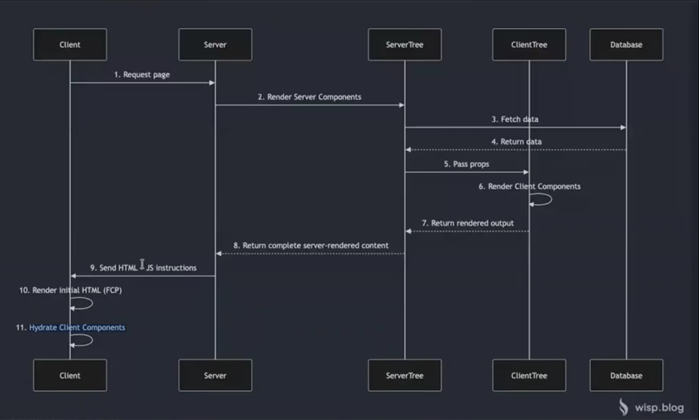

# Next

- là framework của React. Kiến thức từ React đc bảo lưu. Chỉ k dùng Router.
- dùng React 19: có compiler nên k cần useMemo, useCallback, react.memo, k cần forwardRef
- chạy bằng app router nên có folder app

Nên học Typescript

npx create-next-app@latest

- dùng App Router của Next nên sinh ra folder app (code routing)
- page.js trang chủ

- Extension: ES7+ React/Redux/React-Native snippets

- Tên page đặt gì cx đc để dễ quản lý chứ k import vào các Component khác

## Cách hoạt động

- Next Server:
    - Chạy bằng NodeJS
    - Render react component (ở phía server)
    - -> html
    - -> Browser
- Lợi ích:
    - Server render html sau khi xử lý xong (cpu client chỉ cần hiển thị)
    - SEO: html đã có đủ -> bot dễ tìm (React chỉ có root rỗng)

- React:
    - React Client Component (RCC): React
    - React Server Component (RSC): Next

## Đặc điểm

- Mặc định sẽ là Server Component
- Server Component sẽ k dùng được:
    - API trình duyệt: localStorage, DOM, ...
    - React Hook: useState, useEffect, useContext,...

- Vì Next trả về html thô

-> Để tương tác: bắt event, dùng hook -> dùng client component

## Client Component

### Summary:

- cách chuyển từ Server sang Client Component: "use client" ở đầu file
- "Chỉ chuyển client khi nút đó gọi API"
- Hydration: gắn js vào đúng component trong html thô
- Cách hoạt động: Client prerender tạo khung html -> Tải JS -> Hydration gắn JS vào html -> Rerender

- Mặc định page là Server Component r, page trong layout -> layout cx là server

- Cách hoạt động:
    - Lần tải đầu tiên: Client Component sẽ thực hiện quá trình prerender --> tạo ra bộ khung html tĩnh trên server và trả về cho client
    - Trình duyệt sẽ tải JavaScript (Bản đóng gói client component, React) từ Next Server về
    - Trình duyệt tải React Server Component Payload (Thông qua network): Chứa thông tin hướng dẫn để trình duyệt sẽ thực hiện gắn sự kiện, thao tác liên quan đến state, lifecycle,...
    - Xảy ra quá trình Hydration (chỉ trong lần tải đầu tiên) => Giúp React sống lại phía trình duyệt
    - https://images.viblo.asia/98478c3a-a8b7-4e14-8e11-eff4e4936218.png
    - K nên spam "use client" ở đầu: vì file JS (đóng gói từ Next) tải về phía trình duyệt nặng -> nặng, mất hiệu năng, SEO
    - Lời khuyên: Nếu k cần thiết phải dùng API trình duyệt, react hook (Tương tác) ==> K chuyển về client component
    - Vd: Có 1 Server Component, bên trong cần click vào 1 nút thì chỉ chuyển nút đó sang client, các html liên quan sẽ k chuyển
    - 
    - Cần RSC Payload hướng dẫn để biết vị trí nút cần gán sự kiện vào trong file html thô server trả về client

- Lưu ý khi truyền props từ Server Component xuống Client Component
- Props k chấp nhận:
    - function: () => {}
    - Symbol
    - class instance
- Khi truyền props xuống client component --> để quá trình Hydration diễn ra chính xác --> Next yêu cầu trong RSC Payload phải có giá trị props
- RSC Payload -> lưu trữ dạng JSON-Like (Text).
  (Props trong RSC Payload chỉ tồn tại từ Server xuống Client. Trình duyệt cần có thông tin trong RSC Payload thì hydration mới chính xác đc. RSCP chỉ chứa dạng text, mà function, symbol, class instance k chuyển sang text đc)

- Tại sao chỉ có server component cần RSC Payload? ==> Giải quyết bài toán Navigation

## Navigation

Cách navigation trong Next:

- dùng component Link (của Next)
- Khi user bấm vào component Link ==> Trình duyệt gọi api đặc biệt lên next server ==> lấy RSC Payload của trang mới
  ==> !So sánh thực điểm khác nhau với RSC Payload của trang cũ
  ==> Dùng React DOM để cập nhập lại những phần thay đổi (xử lý ở trình duyệt)

## Routing

- Tên trong folder trong app phải tên là page.jsx(tsx) giúp tự sinh ra route
- Private route: _component (thêm _ trc tên để k tự sinh route)
- Bỏ qua route: (home) -> hiểu là folder gốc
- Khi muốn đổi tên route thì k đổi tên folder, k đặt tên folder = tiếng việt -> cấu hình require trong next config

## Common error

- localStorage.setItem viết ở nav là ở Server component, mà server k có localStorage -> lỗi. => Dùng useEffect để hiện đợi component chuyển về client rồi mới chạy (k cho chạy ở Server)

- Math.random() fail vì prerender và render làm tạo 2 giá trị khác -> dùng state & useEffect

- Các dữ liệu dễ bị thay đổi giữa client và server: 
    - múi giờ server # client
    - random
    - chuyển đổi tình trạng tiền tệ (US: 12,000; VN: 12.000). => khai báo chung number.toLocaleString("vi-VN")